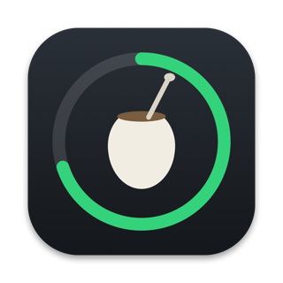

<p align="center">
  
</p>

<h1 align="center">Mate</h1>

<p align="center">
  Una app gratis y open source para macOS que muestra <b>cuánto te queda de los límites de uso de tus agentes de IA</b>, al lado del notch.
</p>

<p align="center"><a href="https://mate-mac.app"><b>mate-mac.app</b></a> · <a href="README.md">Read in English</a></p>

<p align="center">
  <a href="LICENSE"></a>
  
</p>

---

Mientras un agente trabaja, un anillito al lado del notch muestra cuánto usaste de la sesión de 5 horas (o de la semana, cuando es la que se está acabando), con el color del ritmo. Pasá el mouse por el notch y baja un panel negro con todos los medidores, a qué hora se reinicia cada uno y si vas bien o se te está por acabar. Las alertas bajan desde el notch al 75, 90 y 100 %.

En Uruguay el mate se va pasando y recargando, un poco como un cupo; en inglés *mate* es "compañero".

Mate está inspirada en [Agent Limit](https://agentlimit.app), una app paga muy bien hecha que tuvo la idea primero: si querés un producto pulido y con soporte, compralo. Mate es una versión independiente y open source de la misma idea, para **todos los agentes y varias cuentas por agente**. No comparte código con ella.

> La interfaz sigue el idioma de tu Mac: español o inglés (cualquier otro idioma muestra inglés). También se elige en Configuración → General.

## Qué hace

- **Pill junto al notch**: un anillo con el porcentaje de la sesión del agente activo. Cuando una ventana semanal llega al 80 % muestra esa, con la etiqueta "sem", y cualquier ventana al 100 % gana. Aparece mientras un agente escribe sus logs de sesión y se oculta cuando no hay nada corriendo (o se muestra siempre, si preferís).
- **Panel al pasar el mouse**: medidores de sesión y semanal (y Opus/Sonnet, ciclo de facturación, presupuesto mensual o cupos diarios cuando el proveedor los tiene), horas de reset, ritmo, el proyecto en el que estás y una fila de sesión en vivo con el tiempo y los tokens. Pasá de cuenta deslizando dos dedos de costado en el trackpad (una cuenta por gesto) o tocando los puntitos del indicador. Click derecho: Uso, Configuración, Actualizar ahora, Pausar y Salir.
- **Ritmo**: *al día*, *va rápido*, *se acaba a las 16:40* (proyección con la última hora), *límite alcanzado*.
- **Alertas desde el notch** cuando una ventana cruza el 75 / 90 / 100 % y cuando se reinicia; los umbrales y los proveedores se pueden cambiar, y las notificaciones del sistema son opcionales.
- **Ventana de uso**: tokens por día de los últimos 7 días y el desglose de 30 días por modelo con un costo estimado a precio de API, desde los logs locales de los agentes.
- **Varias cuentas por agente**: se suman solas cuando hacés `/login` con otra cuenta (Mate se queda con una copia de la anterior), con el login del propio proveedor (Claude y Codex) o apuntando a otro `CLAUDE_CONFIG_DIR` / `CODEX_HOME`. Renombralas, poneles color, ocultalas o borralas.
- **Macs sin notch y pantallas externas**: Mate dibuja su propio notch.
- **Liviana**: Swift nativo, sin polling. Reacciona a eventos del sistema de archivos y solo se despierta para pedir el uso (cada 5 minutos con un agente activo, cada 30 si no). Alrededor de 0 % de CPU y ~10 MB de memoria en reposo.
- *Próximamente:* **Usar en Claude Code**, para cambiar con un click la cuenta activa de Claude Code.

## Proveedores

| Agente | Dónde lee Mate la sesión | Qué pide y a dónde |
|---|---|---|
| Claude (Claude Code) | Ítem del llavero `Claude Code-credentials`, identidad en `~/.claude.json` | Ventanas de uso de `api.anthropic.com` (`/api/oauth/usage`); refresh del token (solo cuentas que posee Mate) en `platform.claude.com`. Tokens desde `~/.claude/projects/**/*.jsonl` |
| Codex | `~/.codex/auth.json` (o `$CODEX_HOME`) | Uso de `chatgpt.com` (`/backend-api/wham/usage`); refresh del token (solo cuentas que posee Mate) en `auth.openai.com`. Tokens desde `~/.codex/sessions` |
| Cursor | El `state.vscdb` de Cursor (solo lectura) | Período de facturación actual de `api2.cursor.sh` |
| Gemini CLI | `~/.gemini/oauth_creds.json` (solo lectura) | Cupo diario por modelo de `cloudcode-pa.googleapis.com` |
| GitHub Copilot | El token de las apps de Copilot en `~/.config/github-copilot`, si no `gh auth token` (solo lectura) | Cupo de premium requests de `api.github.com` |
| Grok | No hay sesión local: una management key y un team id que ponés en Configuración → Grok | Gasto mensual de la API desde la management API de xAI (`management-api.x.ai`), contra el presupuesto que elijas |

> **Ojo: son endpoints sin documentar.** Ninguno es una API oficial y pública para terceros: son las llamadas que hacen las propias apps y paneles de los agentes. Pueden cambiar o dejar de andar en cualquier momento, y a un proveedor podría no gustarle que se usen así. Cada proveedor está aislado en su propio archivo para poder arreglarlo en una actualización. Usá Mate bajo tu propio riesgo.

## Privacidad

- **Cada token va solo al servidor de su proveedor** (la tabla de arriba). Las redirecciones a otro host se rechazan. La única otra conexión es el chequeo de actualizaciones, a `api.github.com` (y a los servidores de descarga de GitHub cuando aceptás una actualización).
- **Sin telemetría, sin cuentas, sin analíticas.** Nada tuyo sale de la Mac.
- **Las cuentas que está usando un agente son de solo lectura.** Mate nunca refresca ni reescribe el token de la cuenta con la que está logueado Claude Code o Codex (los refresh tokens rotan: hacerlo desloguearía al agente). Si ese token venció, Mate espera a que el agente lo refresque y mientras muestra el último dato con "hace N min". Cursor, Gemini CLI y Copilot son siempre de solo lectura.
- **Las cuentas que posee Mate** (una cuenta anterior que el agente dejó de usar, o una sumada con "Agregar cuenta…") guardan sus tokens solo en los ítems del llavero de Mate (`io.github.coru29.Mate.<proveedor>`), y Mate los refresca. Borrar una de esas cuentas borra la copia de Mate y nunca toca la sesión del agente.
- **Qué escribe el cambio de cuenta (próximamente).** "Usar en Claude Code" va a ser el único lugar en el que Mate escribe en la sesión de un agente: va a reemplazar el ítem del llavero `Claude Code-credentials` y la identidad visible (`oauthAccount`) de `~/.claude.json` por la cuenta elegida, después de guardar una copia para deshacerlo, y pregunta antes de la primera vez. Todavía no está hecho.
- Los datos (cuentas sin tokens, muestras de uso, totales diarios de tokens) están en `~/Library/Application Support/Mate/`; las preferencias, en el dominio `io.github.coru29.Mate`.

Ver [SECURITY.md](SECURITY.md).

## Requisitos

macOS 14 Sonoma o posterior en Apple silicon.

## Instalación

1. Bajá **Mate.dmg** del release más nuevo en [Releases](https://github.com/Coru29/mate/releases) (o compilalo, más abajo) y arrastrá **Mate** a Aplicaciones.
2. Mate no está notarizada por Apple, así que macOS no la abre la primera vez. **Click derecho en la app → Abrir** (en macOS recientes, andá a **Configuración del Sistema → Privacidad y seguridad** y tocá **Abrir igualmente**), o corré `xattr -dr com.apple.quarantine /Applications/Mate.app`.
3. Un asistente corto detecta los agentes que tienen sesión en tu Mac. Cuando macOS pregunte **"Mate quiere acceder a … de tu llavero"** (por el ítem de Claude Code), poné tu contraseña y tocá **Permitir siempre**: Mate lee ese ítem, y con "Permitir siempre" macOS no vuelve a preguntar, ni siquiera después de una actualización (vienen firmadas con el mismo certificado).

Mate no tiene ícono en el Dock ni en la barra de menú: vive en el notch. Abrirla de nuevo desde Aplicaciones o Spotlight abre la Configuración.

### Actualizaciones

Mate mira GitHub un rato después de abrirse y una vez por día (se apaga en Configuración → Actualizaciones). Cuando hay una versión nueva baja una alerta desde el notch, una sola vez ("Mate X disponible — click para instalar"), y Configuración → Actualizaciones y el menú del click derecho ofrecen **Instalar Mate X…**. Al instalar, baja el release, verifica que esté firmado con el mismo certificado que la app abierta, reemplaza la app y la vuelve a abrir. Las versiones 0.x se publican como pre-releases de GitHub, y las copias 0.x las toman.

## Compilar desde el código

Alcanza con las **Command Line Tools** de Xcode (Swift 6); no hace falta Xcode.

```sh
git clone https://github.com/Coru29/mate && cd mate
scripts/test.sh                 # tests (Swift Testing)
scripts/check-localization.sh   # cada texto visible tiene su línea en inglés
scripts/build.sh                # build/Mate.app, firmada
scripts/dmg.sh                  # build/Mate.dmg
scripts/install.sh              # copia a /Applications y la abre
build/Mate.app/Contents/MacOS/Mate --fake   # cuentas de prueba, sin red ni llavero
```

**Firma**: `scripts/sign.sh` firma con la identidad del proyecto ("Rambla Local Signing", la misma de [Rambla](https://github.com/Coru29/rambla)) y nunca crea una. **Un fork necesita su propia identidad**: creá un certificado de firma de código autofirmado en un keychain tuyo y apuntá `MATE_SIGNING_KEYCHAIN` a él (su contraseña en `RAMBLA_SIGNING_PASSWORD`). Un build firmado con otra identidad funciona, pero macOS vuelve a pedir el permiso del llavero y no acepta las actualizaciones oficiales (ni las copias oficiales lo aceptan a él).

**Versiones y releases**: los commits siguen [Conventional Commits](https://www.conventionalcommits.org) y la versión se calcula a partir de ellos. Ver [CONTRIBUTING.md](CONTRIBUTING.md).

## Cómo funciona

- `MateCore` es una biblioteca de Swift pura: el modelo, el ritmo, los umbrales de alertas, las reglas de dueño del token, el parseo de las respuestas y los logs de cada proveedor y los agregados diarios. Está cubierta por tests con fixtures anonimizados.
- La app (AppKit + SwiftUI) dibuja el notch en un panel no activante por encima de la barra de menú que solo toma eventos del mouse donde hay algo visible. La actividad sale de un único stream de FSEvents sobre las carpetas de sesiones de los agentes; los pedidos de uso, los resets y el estado "inactivo" son timers de una sola vez con tolerancia amplia, y los pedidos en reposo y el chequeo diario de actualizaciones pasan por `NSBackgroundActivityScheduler`. Ningún timer repetitivo.
- Cada proveedor implementa un protocolo (encontrar sesiones, leer la identidad, pedir el uso, refrescar cuando Mate es dueño del token, leer logs de a poco). Sumar un agente es sumar un archivo.

## Créditos

Inspirada en [Agent Limit](https://agentlimit.app). Los detalles de los proveedores salen del comportamiento de Agent Limit y del proyecto open source [CodexBar](https://github.com/steipete/CodexBar).

## Licencia

[MIT](LICENSE)
